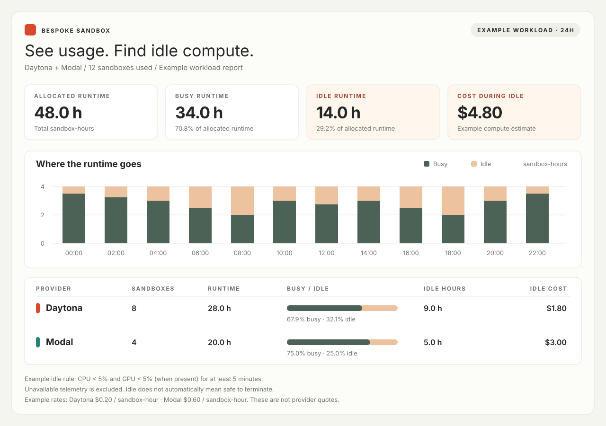
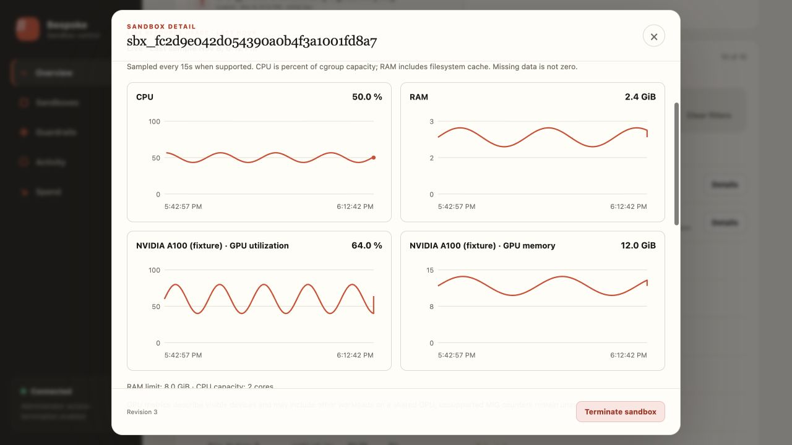

<p align="center">
  <a href="https://bespokelabs.ai/" target="_blank">
    <picture>
      <source media="(prefers-color-scheme: light)" width="100px" srcset="https://github.com/bespokelabsai/curator/blob/main/docs/Bespoke-Labs-Logomark-Red-crop.png">
      
    </picture>
  </a>
</p>

<h1 align="center">Universal Sandbox Interface</h1>
<h3 align="center">One Python API for code and agents across sandbox providers, and observability.</h3>
<br/>

Create a sandbox, run code or shell commands, move files in and out, and clean
up through a common Python API. Run locally or choose Docker, Daytona, E2B,
Modal, and other providers. Add the optional self-hosted control plane when
your team needs a shared dashboard, usage tracking, and provisioning policies.

**[Quickstart](#quickstart)** · **[Run an agent](#run-your-first-agent)** ·
**[Providers](#supported-backends)** · **[Documentation](#documentation)**

## Install

Use Python **3.10+** for the SDK. Install only the provider extras you need;
the core package requires only Pydantic.

```bash
pip install bespokelabs-sandbox
```

See [installation options](docs/INSTALLATION.md) for provider extras, the
server (Python 3.11+), and using Sandbox alongside other Bespoke packages.

## Quickstart

Run your first snippet locally, with no provider account or Docker daemon:

```python
from bespokelabs.sandbox import Sandbox

with Sandbox("local") as sb:
    result = sb.execute_code('print("Ready to run")')
    if result.exit_code != 0:
        raise RuntimeError(result.stderr)
    print(result.stdout)  # Ready to run
```

`local` executes on your host and does not provide an isolation boundary.
The context manager requests cleanup when the block exits, including on errors.
The Docker workflow below runs code in a container.

## Process a file in a sandbox

With Docker installed and running, install the Docker extra:

```bash
pip install 'bespokelabs-sandbox[docker]'
```

This complete workflow seeds a JSON file, processes it in a container, downloads
the output to your machine, and cleans up the container on exit:

```python
import json
from pathlib import Path

from bespokelabs.sandbox import Sandbox

with Sandbox(
    "docker",
    image="python:3.12-slim",
    files={"/tmp/numbers.json": json.dumps([10, 20, 30])},
) as sb:
    result = sb.execute_code("""
import json
from pathlib import Path

numbers = json.loads(Path("/tmp/numbers.json").read_text())
summary = {"count": len(numbers), "total": sum(numbers)}
Path("/tmp/summary.json").write_text(json.dumps(summary))
""")
    if result.exit_code != 0:
        raise RuntimeError(result.stderr)
    sb.download_file("/tmp/summary.json", "sandbox-result.json")

# The downloaded result remains after the sandbox is destroyed.
print(json.loads(Path("sandbox-result.json").read_text()))
# {'count': 3, 'total': 60}
```

Docker pulls the image on the first run if it is not already available.
For shell commands, use `sb.execute_command("python", ["/path/to/script.py"])`.
Code and command results expose `stdout`, `stderr`, and `exit_code`; inspect the
exit code for command failures. Provider or transport failures can raise
[`SandboxError`](docs/SDK_REFERENCE.md#errors).

The same API works with configured cloud providers, subject to their
[feature support](docs/BACKENDS.md#feature-support-matrix). See the reference for
[repository and directory setup](docs/SDK_REFERENCE.md#workspace-convenience-arguments),
[file operations](docs/SDK_REFERENCE.md#file-operations), and
[async execution](docs/SDK_REFERENCE.md#async).

## Run your first agent

Use the same Docker installation to run a CLI agent inside a sandbox. This
example uses the `codex` preset, which installs the CLI at startup on the
backend's base image. Provide your model API key in the environment before
running the Python example:

```bash
export CODEX_API_KEY='your-api-key'
```

```python
import os

from bespokelabs.sandbox import Sandbox

with Sandbox(
    "docker",
    preset="codex",
    env_vars={"CODEX_API_KEY": os.environ["CODEX_API_KEY"]},
    files={"/tmp/example.py": "def average(xs):\n    return sum(xs) / len(xs)\n"},
) as sb:
    result = sb.run_agent(
        "Read /tmp/example.py. Explain what happens for an empty list and "
        "suggest a fix. Do not modify files.",
        harness="codex",
        extra_args=["--skip-git-repo-check"],
    )
    if result.exit_code != 0:
        raise RuntimeError(result.stderr or result.stdout)
    print(result.text)
    print("Tokens:", result.usage.total_tokens)
```

This makes a model API call using your account. `--skip-git-repo-check` allows
this file-only example to run without a Git repository. Startup installation
needs network access and adds setup time. The preset installs tools; it does
not supply credentials. `preset=` selects the environment and `harness=`
selects the CLI that `run_agent()` invokes.

Use `run_agent()` for supported CLI agents and normalized output and usage.
Use `agent(AgentSpec.inside(...))` when you need a custom command, working
directory, or prompt delivery mode. For an agent running in your own process,
use `agent_tools()` or `AgentSpec.outside(...)` to drive the sandbox.

The [agent guide](docs/AGENT_GUIDE.md) covers Claude Code, Codex, OpenCode, Grok,
custom runners, presets, and resuming conversations. Direct SDK runs are not
uploaded to the dashboard; use the
[hosted agent workflow](docs/AGENT_GUIDE.md#token-usage--cost) to persist usage
in the control plane.

## Supported Backends

### Local

Local execution needs no provider account. Docker, Ray, and Safehouse have
the runtime requirements listed below.

| Backend | Extra | Requires |
|---|---|---|
| Local subprocess | _(none)_ | Python installed |
| [Monty](https://github.com/pydantic/monty) | `[monty]` | Bundled Monty worker binary |
| [Agent Safehouse](https://github.com/eugene1g/agent-safehouse) | _(none)_ | macOS + `safehouse` CLI |
| [Docker](https://www.docker.com) | `[docker]` | Docker daemon running |
| [Ray](https://www.ray.io) | `[ray]` | Ray installed (local or remote cluster) |

### Cloud

| Backend | Extra | Auth |
|---|---|---|
| [Daytona](https://www.daytona.io) | `[daytona]` | `DAYTONA_API_KEY` |
| [Tensorlake](https://tensorlake.ai) | `[tensorlake]` | `TENSORLAKE_API_KEY` or `tl login` |
| [Modal](https://modal.com) | `[modal]` | `MODAL_TOKEN_ID` + `MODAL_TOKEN_SECRET` |
| [RunPod](https://www.runpod.io) | _(none)_ | `RUNPOD_API_KEY` + registered SSH key |
| [E2B](https://e2b.dev) | `[e2b]` | `E2B_API_KEY` |
| [boxd](https://boxd.sh) | `[boxd]` | `BOXD_API_KEY` |
| [Google Cloud Batch](https://cloud.google.com/batch) (jobs only) | `[gcp-batch]` | Application Default Credentials |

You only need to install the backend you use. The others are lazily imported.

Local and Ray execute subprocesses on the host or Ray worker and inherit its
environment. Their workspace path rewriting is a convenience, not an OS
security boundary. Safehouse wraps subprocesses with its macOS policy, while
its file helpers still access the host directly. Use the isolation properties
of your selected backend when deciding which workloads to run.

See the [feature matrix](docs/BACKENDS.md#feature-support-matrix),
[credential setup](docs/BACKENDS.md#environment-variables), and
[Monty guide](docs/BACKENDS.md#monty-local-python-execution) for adapter details.

## Hosted control plane

Add the self-hosted control plane when a team needs shared visibility and
policies. Provider credentials stay on your server; applications connect with
organization-scoped product keys through `RemoteSandboxClient` or HTTP.
The direct SDK works independently, and its runs are not automatically uploaded.

The dashboard shows resource usage, compute spend, hosted agent token and model
cost records, execution history, and cleanup state. Provisioning policies cover
concurrency, compute spend, allowed providers and GPUs, and requested lifetimes.



*Illustrative Docker + Monty + Daytona workload, with measured resource peaks from
small live smoke tests shown separately. Monty resource telemetry is unavailable
and excluded from idle totals. Cost estimates exclude local host compute.*

<details>
<summary>See the current per-sandbox dashboard</summary>



*Actual dashboard with fixture data. Resource charts refresh every 15 seconds;
available metrics depend on the provider and sandbox image.*

</details>

Follow the [control plane setup guide](docs/CONTROL_PLANE_GUIDE.md) to install
the server, configure a provider, issue a product key, run a client job, and
open the dashboard.

This is a service you operate. Run one API process per SQLite database;
execution handles do not survive a server restart. Resource metrics require a
compatible image, and restart reconciliation and cleanup require
deployment-supplied adapters. Compute budget checks apply at creation and
exclude model spend. See the [operations runbook](docs/CONTROL_PLANE_OPERATIONS.md)
before deploying.

## Documentation

| Guide | Contents |
|---|---|
| [Installation](docs/INSTALLATION.md) | Python versions, provider extras, server installation, package compatibility |
| [Backends and feature support](docs/BACKENDS.md) | Provider requirements, Monty, feature matrix, environment variables |
| [Python SDK reference](docs/SDK_REFERENCE.md) | Creation options, execution, files, workspaces, networking, GPUs, jobs, snapshots, lifecycle, async, errors, telemetry |
| [Running agents](docs/AGENT_GUIDE.md) | Agent placement, CLI harnesses, presets, token usage, cost reporting, Envy |
| [Control plane setup](docs/CONTROL_PLANE_GUIDE.md) | Server setup, product keys, remote execution, dashboard, policies |
| [Control plane operations](docs/CONTROL_PLANE_OPERATIONS.md) | Deployment, supervision, recovery, and operating limits |
| [HTTP API contract](docs/CONTROL_PLANE_API.md) | Endpoints, authentication, request semantics, and exports |

## Examples

Run examples from a source checkout after installing the package. Each script
lists its own provider and agent prerequisites.

| Example | Demonstrates |
|---|---|
| [move_files_into_sandbox.py](examples/move_files_into_sandbox.py) | Generated local directory, file-map seeding, and live transfers |
| [find_cheapest.py](examples/find_cheapest.py) | Cold-start/execution benchmarks and bundled compute estimates |
| [sandbox_repo.py](examples/sandbox_repo.py) | Claude Code or Codex inside Daytona/Tensorlake, with a clone or web input |
| [claude_code_outside.py](examples/claude_code_outside.py) | Host-side agent driving sandbox commands through a local bridge |
| [claude_code_persona.py](examples/claude_code_persona.py) | Declarative workspace and agent persona files |
| [github_stats.py](examples/github_stats.py) | Parsing agent output into a Pydantic model |

A local transfer demo needs no cloud credentials or agent CLI:

```bash
python examples/move_files_into_sandbox.py --backend local
```

## Development

See the [development setup guide](docs/DEVELOPMENT_GUIDE.md) for environment
setup, tests, linting, and the codebase map. [DEVELOPMENT.md](DEVELOPMENT.md)
describes design direction and compatibility rules.

## License

[Apache License 2.0](LICENSE).
