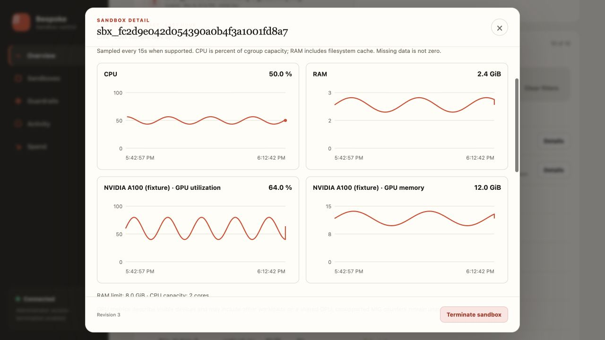

# Control plane setup and dashboard

[Back to README](../README.md)

Use this guide to deploy the self-hosted service and run a sandbox through its API. The [direct SDK](../README.md#quickstart) works independently of this service.

**On this page**

- [Choose how to run](#choose-how-to-run)
- [Visibility and control, across providers](#visibility-and-control-across-providers)
- [See what your agents are using](#see-what-your-agents-are-using)
- [Understand the cost of a run](#understand-the-cost-of-a-run)
- [Set boundaries before resources are created](#set-boundaries-before-resources-are-created)
- [Investigate and act from one place](#investigate-and-act-from-one-place)
- [Hosted control plane](#hosted-control-plane)
- [1. Install the server and provider](#1-install-the-server-and-provider)
- [2. Configure and start the server](#2-configure-and-start-the-server)
- [3. Issue the initial product API key](#3-issue-the-initial-product-api-key)
- [4. Run a client job](#4-run-a-client-job)
- [5. Inspect usage in the dashboard](#5-inspect-usage-in-the-dashboard)
- [Security and deployment notes](#security-and-deployment-notes)

## Choose how to run

| | Direct SDK | Self-hosted control plane |
|---|---|---|
| Best fit | An application or agent that manages its own sandboxes | A team or platform that needs shared visibility and policies |
| Client | `Sandbox` / `SandboxClient` | `RemoteSandboxClient` or HTTP |
| Provider credentials | In your application's environment | On the control-plane server |
| Operational visibility | Execution results, SDK usage, and lifecycle telemetry hooks | Dashboard, persisted usage, scoped access, policies, and audit history |
| Start here | [Local quickstart](../README.md#quickstart) | [Server setup](#hosted-control-plane) |

The direct SDK works independently of the server; its runs are not automatically
uploaded to the dashboard. Both paths use explicit backend selection. You can
change providers through the same interface, subject to their supported features;
automatic failover and cheapest-provider routing are not implemented.

## Visibility and control, across providers

### See what your agents are using

Open a sandbox to inspect its CPU and RAM history, GPU utilization and memory,
execution history, and lifecycle timeline. Find the creator key, provider
resource, age, and cleanup status in the inventory. Missing or stale measurements
are labeled explicitly, so an unavailable metric never looks like an idle machine.

<details>
<summary>See the current per-sandbox dashboard</summary>



*Actual dashboard with fixture data. Resource charts refresh every 15 seconds;
available metrics depend on the provider and sandbox image.*

</details>

### Understand the cost of a run

Track sandbox compute spend by day, provider, or sandbox. For hosted agent runs,
see input, output, and cached tokens alongside reported model costs and labeled
Codex cost estimates. Compute spend and model spend remain separate, with the
source and assumptions visible where they matter.

### Set boundaries before resources are created

Keep provider credentials on your server and give teams organization-scoped
product keys. Set concurrency limits, compute spend thresholds, allowed providers
and GPU types, and maximum requested lifetimes. Creation requests are checked
before provisioning; configured sandbox deadlines let the supervisor clean up
attached resources even after the client disconnects.

### Investigate and act from one place

Filter the inventory, inspect failed launches, review policy denials and audit
events, and terminate a sandbox with the appropriate permissions. Export usage,
costs, and ledger entries for analysis. Connect the direct SDK's lifecycle events
to your own metrics tooling when you want execution telemetry in an existing stack.

| What you need | What you get |
|---|---|
| Visibility into resource consumption | Per-sandbox CPU/RAM charts and visible NVIDIA device metrics where supported |
| Cost attribution | Organization and sandbox compute metering, plus token/cost records from hosted agent runs |
| Control over provisioning | Scoped keys, concurrency and compute-spend checks, provider/GPU allowlists, and lifetime limits |
| An operational trail | Creation attempts, executions, errors, cleanup state, alerts, audit events, and CSV exports |
| Flexibility across providers | Common execution and file APIs, with explicit backend selection and provider-specific options |

The control plane is a service **you operate**. Live resource metrics require a
compatible image; model usage is captured through hosted `run_agent` calls.
Provider reconciliation and cleanup after a server restart require
deployment-supplied adapters. Compute budget checks apply at creation and do not
include model spend. See the [setup and operating details](#hosted-control-plane).

## Hosted control plane

Give your users one product API key and your operators one place to manage
their sandboxes. Clients send work to your control plane; it authenticates the
organization, checks creation policies, calls the selected provider, and records
usage against the organization and sandbox.

The dashboard brings together three views of the same workload:

- **Resources:** what is running, who created it, how much CPU/RAM/GPU it uses,
  and when it expires.
- **Spend:** sandbox compute costs and, for hosted agent runs, tokens and model
  costs with reported values and estimates clearly distinguished.
- **Operations:** creation failures, execution history, policy denials, alerts,
  audit events, and permission-controlled termination.

Use the five steps below to go from a server installation to a metered run you
can inspect in the dashboard. For deployment details, keep the
[operations runbook](CONTROL_PLANE_OPERATIONS.md) and
[HTTP API contract](CONTROL_PLANE_API.md) alongside this guide.

This is a self-hosted service shipped in the repository. Run **one API process
per SQLite database**: live sandbox handles are held in that process, and
execution cannot resume automatically after a restart. Graceful shutdown
attempts to destroy the process's attached sandboxes.

### 1. Install the server and provider

Install only the provider adapters enabled by this deployment. For a local and
E2B development server:

```bash
pip install 'bespokelabs-sandbox[server,e2b]'
```

From a source checkout, use:

```bash
pip install -e '.[server,e2b]'
```

### 2. Configure and start the server

Provider credentials belong on the server. Customers never receive them.

```bash
export BESPOKE_API_KEY_PEPPER='replace-with-a-long-random-secret'
export BESPOKE_CONTROL_PLANE_ADMIN_TOKEN='replace-with-another-random-secret'
export BESPOKE_CONTROL_PLANE_DB='/absolute/path/to/bespoke-control-plane.db'
export BESPOKE_ALLOWED_BACKENDS='local,e2b'
export BESPOKE_CUSTOMER_MARKUP='1.20'
export BESPOKE_SUPERVISION_INTERVAL_SECS='30'
export BESPOKE_SESSION_COOKIE_SECURE='1'
export BESPOKE_DASHBOARD_SESSION_TTL_SECS='28800'

# Provider credential — server-side only.
export E2B_API_KEY='your-e2b-api-key'

bespokelabs-sandbox-api
```

Verify that it is running:

```bash
curl http://127.0.0.1:8000/healthz
# {"status":"ok"}
```

`BESPOKE_API_KEY_PEPPER` and `BESPOKE_CONTROL_PLANE_DB` are persistent server
identity. Keep both values unchanged across restarts. Changing the pepper or
pointing at another database makes previously issued product keys invalid.
The backend allowlist is also read at startup, so restart the server after
changing `BESPOKE_ALLOWED_BACKENDS`. If omitted, all registered backends are
allowed; set an explicit list for your deployment. `HOST` and `PORT` default to
`127.0.0.1` and `8000`. The CLI serves HTTP; terminate HTTPS at a reverse proxy
for the secure dashboard cookie.

<details>
<summary>Provider configuration, health checks, and restart recovery</summary>

Provider configuration is server-owned. The control plane reads the standard
Daytona, E2B, Modal, Runpod, Tensorlake, and boxd credential variables into memory;
it never returns their names or values through the product API. Scoped
provider-health responses expose only the backend, configured state, health
state, check time, and a fixed safe message. A configured provider remains
`unchecked` unless a deployment-supplied health checker actually runs; only a
successful check is reported as `healthy`.

The stock `bespokelabs-sandbox-api` CLI wires provider settings for safe
configuration visibility only. It does **not** construct provider health
checkers, reconcilers, or out-of-process terminators. Consequently, stock-CLI
provider health remains `unchecked`, reconciliation is unavailable, and a
restarted process cannot reclaim a real cloud resource whose in-memory runtime
was lost. A production deployment requiring those capabilities must instantiate
`ControlPlane` in deployment code and inject provider-specific health-check,
reconciler, and terminator adapters after testing them against that provider.

</details>

### 3. Issue the initial product API key

Issue an organization's initial product key through the protected bootstrap
endpoint. The returned `secret` is shown only in this response:

```bash
curl -X POST http://127.0.0.1:8000/v1/organizations \
  -H "X-Control-Plane-Admin: $BESPOKE_CONTROL_PLANE_ADMIN_TOKEN" \
  -H 'Content-Type: application/json' \
  -d '{"name":"Acme"}'
```

Copy the returned value beginning with `bsk_live_`. That is the customer-facing
product key. It is different from `E2B_API_KEY` and works across every backend
enabled by the server.

### 4. Run a client job

Set the product key in the client environment:

```bash
export BESPOKE_SANDBOX_KEY='bsk_live_...'
```

Then create and use a sandbox through the remote client:

```python
import os

from bespokelabs.sandbox import RemoteSandboxClient

client = RemoteSandboxClient(
    "http://127.0.0.1:8000",
    os.environ["BESPOKE_SANDBOX_KEY"],
)

with client.create(
    "e2b",
    timeout_secs=60,
    idempotency_key="example-launch-001",
) as sandbox:
    result = sandbox.execute_code(
        'print("hello from E2B")',
        idempotency_key="example-job-001",
    )
    print(result.stdout)
    print(result.usage)

# The same key can create a different provider's sandbox.
with client.create("local") as sandbox:
    result = sandbox.execute_command("python", ["--version"])
    print(result.stdout)

costs = client.costs(group_by="backend")
print(costs)
```

The run is now attributed to its organization and sandbox. Open the dashboard
in step 5 to inspect its lifecycle and compute cost. To capture model tokens and
costs as well, use the hosted [`run_agent` workflow](AGENT_GUIDE.md#token-usage--cost).

<details>
<summary>Request semantics, cost accounting, policies, and cleanup</summary>

The context manager requests sandbox destruction on exit. Creation keys are
scoped to an organization: the same key and payload return the existing record,
including its current status, while a different payload is rejected. Execution
keys are scoped to an organization and sandbox. A completed code/command execution can
return its cached response while the runtime remains attached and running;
an in-progress or failed execution returns a conflict. Code/command payloads are
not compared, so use a new key for each distinct command and reuse it only to
retry that command. The client does not automatically retry HTTP requests.
Hosted agent runs have their own persisted replay and payload checks, described
in [token usage and cost](AGENT_GUIDE.md#token-usage--cost).

`RemoteSandboxClient(..., timeout_secs=60)` sets the HTTP request timeout;
`client.create(..., timeout_secs=60)` sets the sandbox timeout. Allow enough
HTTP time for provider creation. A client timeout does not cancel server work.

The remote surface currently supports creation, inventory (`list` / `get`),
code/command execution, `run_agent`, destruction, costs, and reconciliation.
Hosted `run_agent` records model usage for the dashboard. The remote client does
not expose the direct SDK's file transfers, `Manifest`, `backend_options`,
`AgentSpec` bindings, structured `return_type`, snapshot creation, or session resume. See the
[API contract](CONTROL_PLANE_API.md) for the remaining HTTP endpoints.
Cost amounts and durations arrive as decimal strings; `group_by` accepts
`"sandbox"`, `"backend"`, or `"day"`.

Provider failures expose a stable error contract in both HTTP responses and
`RemoteSandboxError`: `code`, `backend`, `op`, `retryable`, `outcome`, and a
small, redacted `context`. Sandbox responses include `attempt_count`,
`latest_error`, `retry_status`, `cleanup_status`, and `provider_resource_id`.
An ambiguous create has `outcome="unknown"` and
`retry_status="blocked_cleanup_unknown"`; do not issue a new provider create
until the possible orphan has been reconciled manually.

Sandbox records also expose requested, provisioning, running, stopping,
terminated, failed, and last-provider-observation timestamps. Lifecycle cost
uses the rate, currency, and pricing-source snapshot captured at creation and
accrues across the whole provider-billable window, including failed setup and
cleanup. `GET /v1/reconciliation` returns tenant-scoped health; an operator can
run a configured provider reconciler with
`POST /v1/reconciliation/{backend}` when the deployment injected that backend's
reconciler. Provider-reported cost replaces the
estimate through an idempotent delta ledger, so repeated observations do not
double-count spend. Billable-time deltas are split at UTC day boundaries, so
refreshes and later provider-cost adjustments do not move historical usage
between reporting days.

Sandbox responses also include the creating API-key ID/name and a numeric
`version`. `GET /v1/sandboxes/{id}/detail` returns the tenant-scoped creation
attempts, executions, lifecycle cost, and provider-observation history. A
termination request may send that version in `If-Match`; stale versions are
rejected with `409`, while repeating a successful termination remains
idempotent. `GET /v1/session` reports the current key's scopes and whether the
dashboard may show termination controls.

Organization guardrails are managed with `GET` and `PUT` requests to
`/v1/policies/current`. They can cap concurrent sandboxes, rolling-hour and
UTC-day customer spend, allowed backends, allowed GPU types, and requested
sandbox lifetime. Each create request reserves its concurrency slot and checks
all limits in one database transaction before any provider call. A denial is a
stable, non-retryable `policy_denied` response and is attributed to the API key
that made the request. `GET /v1/policy-summary` returns current quota/spend and
recent denials. Redacted provider health is available from `GET /v1/providers`
and `POST /v1/providers/{backend}/health-check`.

An explicit creation `timeout_secs` also sets the control plane's `expires_at`
on every backend, independently of the provider's own timeout semantics. Omitted
values do not create a supervisor deadline, even when a preset supplies a
recommended timeout. The control-plane supervisor terminates expired sandboxes
even when the client disconnects. Its durable claim state is safe across process
restarts, and configured provider terminators can clean up resources whose
in-memory runtime was lost. Reconciliation watchdogs also remove provider resources that do not
belong to any recorded sandbox, with durable idempotency so a confirmed cleanup
is not repeated. Set `BESPOKE_SUPERVISION_INTERVAL_SECS` to tune the scan
interval. These restart-recovery and reconciliation behaviors require injected
terminator/reconciler adapters; the stock CLI does not supply them.

</details>

### 5. Inspect usage in the dashboard

Open [`http://127.0.0.1:8000/dashboard`](http://127.0.0.1:8000/dashboard) and
enter the `bsk_live_...` product key. For this plain-HTTP loopback example,
set `BESPOKE_SESSION_COOKIE_SECURE=0` before starting the server so the browser
can send its session cookie. Keep the default `1` when serving over HTTPS.

Start with the sandbox you just created: inspect its lifecycle, execution result,
and compute cost. For a still-running sandbox with a compatible image, its detail
panel also shows live resource charts. Hosted agent runs add token and model-cost
records. A local-only example records runtime with zero provider cost.

<details>
<summary>Live metrics: availability, sampling, and retention</summary>

The sandbox detail panel includes live CPU, RAM, and NVIDIA GPU charts for the
last hour. The control plane samples attached, running sandboxes every 15 seconds
independently of the lifecycle watchdog. Read the same history through
`GET /v1/sandboxes/{id}/resources` with both `sandboxes:read` and `usage:read`.
Dashboard refreshes read stored samples, without launching additional probes.

CPU is the average percentage of effective cgroup CPU capacity between samples;
the first sample has no CPU value. RAM is cgroup memory usage including filesystem
cache. The probe requires Python 3 and Linux cgroup v2 in the sandbox image.
Docker, Modal, Daytona, E2B, Runpod, Tensorlake, and Boxd use this probe on a
best-effort basis; missing counters or packages show **unavailable**. Local, Ray,
and Safehouse do not report shared host CPU/RAM as sandbox usage.
GPU charts require `nvidia-smi` and show visible device utilization and memory,
which can include other workloads on shared devices. Unsupported MIG counters
stay unavailable. These resource samples are separate from compute billing and
agent token costs; probes add a small amount of sandbox activity and provider
API traffic, but do not create execution-ledger entries.

The UI labels stale samples after 45 seconds, breaks chart lines across missing
data, and retains historical charts when a sandbox stops. Sampling resumes only
for attached runtimes; after a control-plane restart, historical samples remain
readable but detached sandboxes show unavailable. Storage migration 10 keeps at
most 240 samples per sandbox; an hourly sweep removes observations older than
24 hours while sampling is enabled. Set `BESPOKE_RESOURCE_SAMPLING_INTERVAL_SECS`
to 5–15 to adjust cadence, or 0 to disable sampling. Faster cadences shorten the
240-sample history. At most four probes run concurrently; a provider call that
exceeds ten seconds is marked unavailable and keeps its slot until it returns,
so repeated failures cannot accumulate unbounded workers.

The counter meanings follow the [Linux cgroup v2 documentation](https://www.kernel.org/doc/html/latest/admin-guide/cgroup-v2.html)
and [NVIDIA's monitoring documentation](https://docs.nvidia.com/deploy/nvidia-smi/).

</details>

The initial organization key has every scope. A read-only dashboard key needs
both `usage:read` and `sandboxes:read`.

The dashboard provides:

- operational cards for active resources, failed launches, unreconciled spend,
  and resources nearing their TTL;
- budget/quota progress, backend/GPU/lifetime policy, provider health, and
  recent policy denials when the key has the corresponding read scopes;
- launches for keys with `sandboxes:create` (choose an enabled backend and
  clear the form's `dashboard-cpu` preset default unless your deployment has
  registered that custom preset);
- status, provider, and creation-date filtering with client-side pagination;
- creator key, provider resource, compute/GPU, rate, age/TTL, cleanup, and
  reconciliation state for every sandbox;
- a detail view for lifecycle, attempts, executions, errors, cost, and provider
  observations;
- confirmed, revision-safe termination for keys with `sandboxes:terminate`;
  legacy `sandboxes:write` keys remain compatible; and
- automatic refresh every 15 seconds while the tab is visible, plus manual refresh.

The production dashboard exchanges the product key for an expiring, HTTP-only,
Secure, SameSite=Strict cookie and never stores that key in browser storage.
State-changing requests carry a session-bound CSRF token. For an explicitly
enabled local-only workflow, set `BESPOKE_ENABLE_LOCAL_DASHBOARD_LOGIN=1`, set
`BESPOKE_SESSION_COOKIE_SECURE=0` only when serving plain HTTP on loopback, and
open `/dashboard/local`; that development route keeps the key in the current
tab's `sessionStorage`. Never expose that route on a shared network. Local
sandboxes record runtime but have a provider cost of `$0`; use a priced fake or
cloud backend to exercise spend counters.

The Activity view shows durable alerts and append-only audit history. Operators
with `exports:read` can download paginated CSV pages for usage, lifecycle costs,
and ledger entries. Dashboard export buttons download the first page of up to
500 rows; full exports require following the HTTP `X-Next-Cursor` header as
described in the [API contract](CONTROL_PLANE_API.md#pagination-and-csv).
Alert thresholds and retention periods are tenant-owned and available through
the API. Retention defaults to 90 days for operational history and 365 days for
audit; an explicit retention request preserves usage and financial ledgers.

### Security and deployment notes

API keys, browser session cookies, and CSRF tokens are HMAC-hashed at rest.
Runtime scopes are `sandboxes:read`,
`sandboxes:create`, `sandboxes:execute`, and `sandboxes:terminate`; governance
uses `usage:read`, `policies:read`, `policies:write`, `providers:read`, and
`providers:write`; reconciliation uses `providers:reconcile`; and key issuance
uses `keys:write`. Operational access uses `alerts:read`, `alerts:write`,
`audit:read`, `exports:read`, `retention:read`, and `retention:write`. The legacy
`sandboxes:write` scope grants create, execute, terminate, and provider
reconciliation for compatibility. Runtime events and provider/customer costs
are written to an idempotent ledger. All responses carry a restrictive content
security policy and browser security headers. See the
[operations runbook](CONTROL_PLANE_OPERATIONS.md) and
[hosted API contract](CONTROL_PLANE_API.md) before deployment.

Never commit the API-key pepper, admin token, provider credentials, or product
keys. Revoke and replace a product key if it appears in source code, logs, or
chat. Environment-variable ownership is:

| Value | Where it belongs |
|---|---|
| `E2B_API_KEY` and other provider credentials | Control-plane server only |
| `BESPOKE_API_KEY_PEPPER` | Control-plane server only; stable across restarts |
| `BESPOKE_CONTROL_PLANE_ADMIN_TOKEN` | Administrative bootstrap tooling only |
| `bsk_live_...` / `BESPOKE_SANDBOX_KEY` | Customer client or dashboard |

Common errors:

| Error | Resolution |
|---|---|
| `backend is not enabled: e2b` | Add `e2b` to `BESPOKE_ALLOWED_BACKENDS` and restart the server. |
| `invalid API key` | Confirm the full `bsk_live_...` value, database path, and original pepper. |
| Provider authentication failure | Install that provider's extra and configure its credential on the server. |
