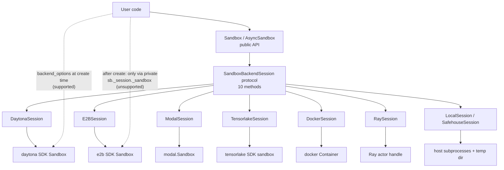
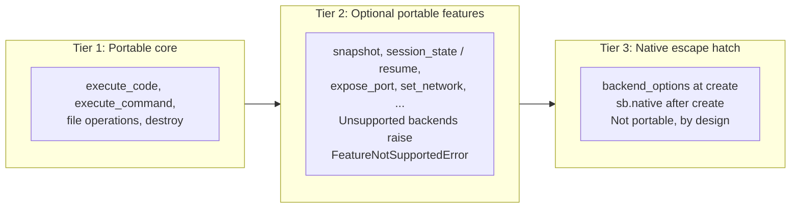
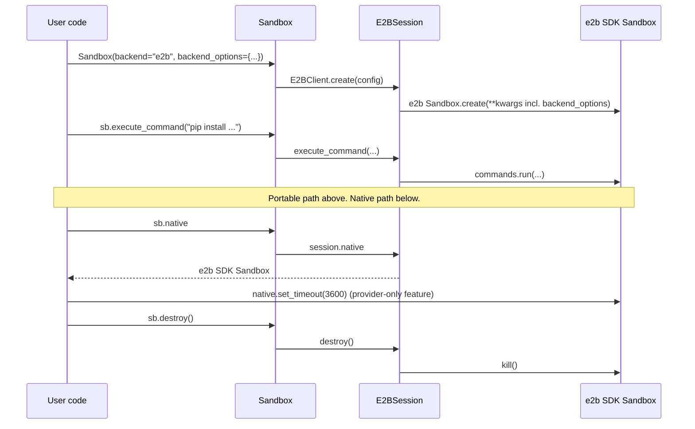
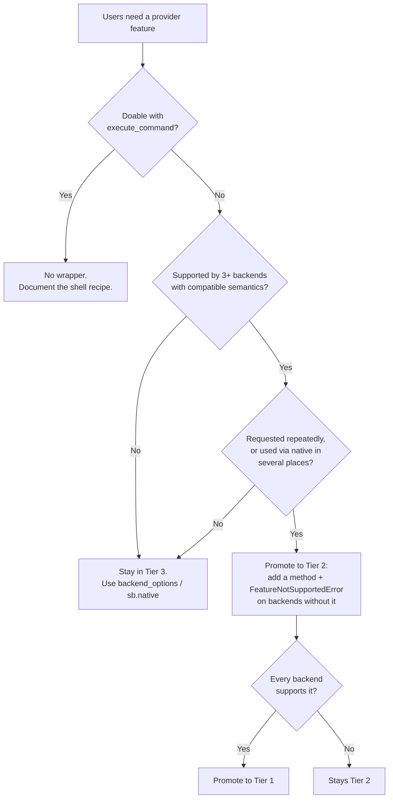
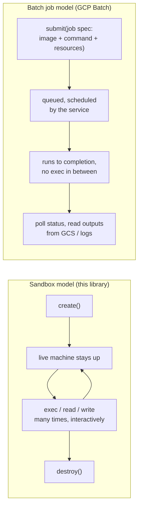

# Design: Provider coverage — core API, optional features, and the `native` escape hatch

- **Status:** Accepted and implemented (`native` in phase 1; capability declaration deferred)
- **Scope:** `Sandbox`, `AsyncSandbox`, `SandboxBackendSession`, every backend in `backends/`
- **History:** design approved in #57; implemented in the follow-up PR that adds `Sandbox.native`.

## Problem

`bespokelabs-sandbox` gives one API over many sandbox providers (Daytona, E2B, Modal,
Tensorlake, Docker, Ray, Local, Safehouse, RunPod, Monty, boxd, with Maritime in an open PR). Each
provider's SDK has far more surface than our API covers: preview URLs and port
forwarding, streaming and background processes, pause/resume, volumes, network
policies, GPU controls, and new features every release.

Two bad ways to handle that:

1. **Wrap everything.** Every provider feature gets a portable method. The maintenance
   cost grows with (providers × features), most features have no equivalent on other
   providers, and we are always behind the provider's own releases.
2. **Wrap nothing beyond the core.** Users who need one provider-specific feature after
   creation have to read private attributes such as `sb._session._sandbox`, or drop the
   library for that workload.

Today the library sits between the two, without a stated rule for which features belong
in the unified API and with no supported route to the provider object after creation.

## Goals

- Keep the portable core small and the per-backend cost at one adapter file.
- Never block a user on a missing wrapper: every provider feature is reachable on day one.
- Make it obvious, in code and in docs, when a call stops being portable.
- Give a clear rule for when a provider feature should become part of the portable API.

## Non-goals

- Wrapping provider-specific features such as preview URLs, volumes, or network policies
  in this change.
- Changing the existing 10-method backend protocol.
- Cost-based routing across providers (the README's "coming soon" item), beyond leaving
  room for it.

## How other multi-provider libraries handle this

| Library | Portable layer | Escape hatch |
|---|---|---|
| OpenRouter | OpenAI-style chat API | Provider-specific parameters passed through untouched |
| SQLAlchemy | Engine, Session, query layer | `connection.connection` returns the raw DB-API driver connection |
| Apache Libcloud | `create_node`, `list_nodes`, … | Provider-specific methods prefixed `ex_` |

The common pattern is a small portable core, optional features that some providers
decline, and a documented way to reach the provider directly. This design adopts that
pattern explicitly.

## Current state



What exists today:

1. **Core contract** — `protocols.py` defines `SandboxBackendSession` with 10 methods:
   `execute_code`, `execute_command`, `list_files`, `read_file`, `write_file`,
   `upload_file`, `download_file`, `snapshot`, `session_state`, `destroy`. Plus
   `SandboxBackendClient.create` / `resume`.
2. **Optional features** — a backend that cannot do something raises
   `FeatureNotSupportedError`. Examples: `snapshot` on Daytona, E2B, Ray, Local and
   Safehouse; `resume` on Ray; `resume` on older Daytona and Tensorlake SDKs.
3. **Escape hatches**
   - `execute_command` — anything doable from a shell inside the sandbox needs no
     wrapper. This covers most real usage.
   - `backend_options` — merged into the provider SDK's create call
     (`docker.py`, `modal.py`, `e2b.py`, `tensorlake.py`, `daytona.py`). Provider-specific
     creation settings work without the library knowing about them.
   - **Gap:** no supported way to reach the live provider object after creation. It is
     held in a private attribute (`self._sandbox`, `self._container`, `self._actor`) and
     `Sandbox` exposes only `backend_name`, `is_alive` and `usage`.

## Proposal

### 1. The three-tier model (stated policy)



| Tier | Contract | Who implements | Portable? |
|---|---|---|---|
| 1. Core | Every backend implements every method: `execute_code`, `execute_command`, `list_files`, `read_file`, `write_file`, `upload_file`, `download_file`, `destroy` | Every backend | Yes |
| 2. Optional | Same signature; may raise `FeatureNotSupportedError`. Today: `snapshot`, `session_state` / `resume`, `expose_port`, `set_network`, `list_sandboxes` | Backends that can | Yes, with a clear error elsewhere |
| 3. Native | `backend_options` in, `sb.native` out | Every backend with a provider object | No |

`snapshot` and `session_state` sit on the backend protocol so every session has the
method, but several backends raise `FeatureNotSupportedError` from them, which makes them
Tier 2, not Tier 1.

### 2. Add `Sandbox.native` (and `AsyncSandbox.native`)

A read-only property returning the provider's own live object:

| Backend | `sb.native` returns |
|---|---|
| `daytona` | Daytona SDK `Sandbox` |
| `e2b` | E2B SDK `Sandbox` |
| `modal` | `modal.Sandbox` |
| `tensorlake` | Tensorlake SDK sandbox object |
| `docker` | `docker.models.containers.Container` |
| `ray` | The Ray actor handle |
| `boxd` | The authenticated `boxd` client. boxd has no per-machine object, so callers pass `sb.provider_resource_id` as the machine id |
| `runpod` | Raises `FeatureNotSupportedError`: driven over REST and SSH, no SDK object |
| `monty`, `local`, `safehouse` | Raises `FeatureNotSupportedError` (there is no provider object) |

Behaviour:

- `AsyncSandbox.native` returns the same synchronous SDK object. Its methods block, so
  async callers run them with `asyncio.to_thread(...)` or use the provider's own async
  API. The async wrapper's no-blocking guarantee covers the methods it wraps, not the
  object `native` hands out; the docstring and SDK reference say so.
- Raises the same error as other methods once the sandbox is destroyed (`_check_alive`).
- Documented as non-portable. The docstring and the SDK reference state that code using it
  is tied to one backend and that its type depends on the provider SDK version.
- The library still owns the lifecycle. Calling the provider's own terminate/kill through
  `native` is unsupported; use `sb.destroy()` so usage tracking and cleanup stay correct.
- Typed as `Any` on `Sandbox`. Users narrow it themselves (for example
  `cast(e2b.Sandbox, sb.native)`), which keeps provider SDKs out of our import graph.



Protocol change, kept backward compatible for third-party backends:

```python
class SandboxBackendSession(Protocol):
    ...
    @property
    def native(self) -> Any: ...
```

`Sandbox.native` reads `getattr(session, "native", ...)` and raises
`FeatureNotSupportedError` if a backend does not define it, so out-of-tree backends keep
working until they add it. All in-tree backends, and Maritime (#45) once it lands, add
the property.

### 3. Rule for promoting a feature into the portable API



Likely early candidates for Tier 2, to be decided case by case: exposing a port as a URL,
streaming command output, and pause/resume.

### 4. (Optional, phase 2) Capability declaration

Each backend client declares what it supports, so callers and future cost-based routing
can check before running instead of failing mid-run:

```python
class E2BClient:
    capabilities = frozenset({"resume"})

class ModalClient:
    capabilities = frozenset({"snapshot", "resume", "gpu"})
```

Exposed as `Sandbox.capabilities` / `SandboxClient.capabilities`. Kept out of phase 1 so
the first change stays small.

## Maintenance cost

| Change | Cost |
|---|---|
| New backend | One adapter file: 10 protocol methods + `native` property |
| New provider feature | Zero. Reachable immediately through `sb.native` |
| New portable feature (Tier 2) | One method on the protocol, one implementation per supporting backend, `FeatureNotSupportedError` elsewhere |

## Out of scope: batch job services (GCP Batch, AWS Batch, Kubernetes Jobs)

Batch services are a different execution model, not another sandbox provider, so they do
not get a backend under this protocol.



| | Sandbox | Batch job |
|---|---|---|
| Lifetime | Stays up until `destroy()` | Ends when the command exits |
| Interaction | Many `execute_command` / file calls | None after submission |
| Files | Read and write live | Staged in and out through object storage |
| Startup | Seconds | Queue + VM provisioning, often minutes |
| Fits `SandboxBackendSession`? | Yes | No: `execute_command`, `read_file`, `write_file` have no equivalent on a running job |

Forcing Batch behind this protocol would mean faking a live session (for example, a long
`sleep` job plus an SSH or agent channel), which loses what Batch is good at: cheap,
queued, fan-out of many independent runs.

This is how GCP Batch landed on `main`: `GcpBatchClient` sets `supports_sessions = False`
and implements a separate `SandboxJobBackend` protocol (`submit_job`, `job_status`,
`job_logs`, `cancel_job`), exposed through `SandboxClient`'s job methods. Other job
services (AWS Batch, Kubernetes Jobs) would implement that protocol, not
`SandboxBackendSession`, so `native` does not apply to them.

## Alternatives considered

- **Proxy unknown attributes with `__getattr__`** so `sb.get_host(...)` forwards to the
  provider. Rejected: it hides the portability boundary, breaks type checking and
  autocompletion, and makes name clashes between our methods and the provider's silent.
- **Libcloud-style `ex_` methods on `Sandbox`.** Rejected for now: still a wrapper per
  feature, so it does not fix the maintenance problem. Can coexist with `native` later.
- **Do nothing; tell users to read `_session._sandbox`.** Rejected: private, undocumented,
  and differs per backend (`_sandbox`, `_container`, `_actor`).

## Implementation (done)

1. Add `native` property to `SandboxBackendSession` and every in-tree backend session.
2. Add `Sandbox.native` and `AsyncSandbox.native` with alive-checks and the fallback for
   backends that lack the property.
3. Tests in `tests/test_native.py`: every backend's return value or error, the
   destroyed-sandbox case, a session without the property, and `AsyncSandbox`.
4. Docs: a "Provider objects (`native`)" section in `docs/SDK_REFERENCE.md`, an async
   note, and a `native` row in the `docs/BACKENDS.md` feature matrix.
5. Still to do: ask the Maritime PR (#45) to add `native`.
6. Deferred: capability declaration (phase 2).

## Decisions on the open questions

1. `local`, `safehouse`, `monty` and `runpod` raise `FeatureNotSupportedError`: none of them
   has a provider object, and a working-directory path is not one.
2. `native` stays typed as `Any`; per-backend overloads can come later without breaking
   callers.
3. Capability declaration is deferred to a separate change.
